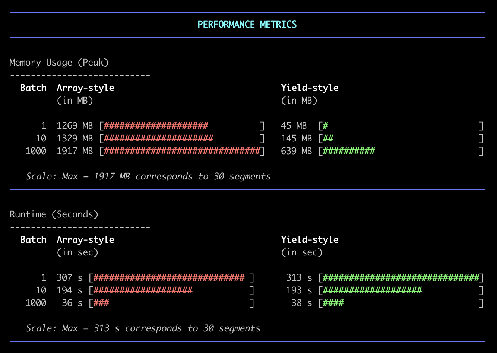

# GSC API Client - Una clase de PHP para una recuperación de datos sencilla desde Google Search Console

Un **cliente de PHP** para la API de Google Search Console que facilita la importación programática de datos de rendimiento de búsqueda en tu aplicación.

## Tabla de Contenidos

- [Requisitos](#requirements)
- [Instalación](#installation)
- [Referencia de la API](#api-reference)
- [Valores de Retorno](#return-values)
  - [Estructura de datos de palabras clave](#keyword-data-structure)
  - [Estructura de datos de URLs](#url-data-structure)
  - [Estructura de datos de URL + Palabra clave](#url--keyword-data-structure)
  - [Estructura de datos de rendimiento de búsqueda por URL](#search-performance-by-url-data-structure)
  - [Estructura de datos de rendimiento de búsqueda por fecha](#search-performance-by-date-data-structure)
- [Ejemplos de uso](#usage-examples)
  - [Archivos de ejemplo](#example-files)
  - [Inicializar el cliente](#initialize-the-client)
  - [Listar propiedades disponibles](#list-available-properties)
  - [Seleccionar una propiedad](#select-a-property)
  - [Establecer rango de fechas](#set-date-range)
  - [Configurar frescura de los datos](#configure-data-freshness)
  - [Obtener datos de rendimiento de búsqueda](#get-search-performance-data)
  - [Configurar procesamiento por lotes](#configure-batch-processing)
  - [Acceder a los datos de palabras clave devueltos](#accessing-returned-keyword-data)
  - [Acceder a los datos de URLs devueltos](#accessing-returned-url-data)
  - [Acceder a los datos de rendimiento por fecha devueltos](#accessing-returned-performance-by-date-data)
- [Requisitos de velocidad y recursos](#speed-and-resource-requirements)
  - [Probado con cuentas de GSC de tamaño considerable](#tested-with-large-ish-gsc-accounts)
    - [Resultados de pruebas](#test-results)
      - [Batch=1 (el camino largo)](#batch1-the-long-way-round)
      - [Batch=10 (acercándose)](#batch10-getting-somewhere)
      - [Batch=1000 (ahora sí que vamos)](#batch1000-now-were-cooking)
      - [Cómo encontrar un BatchSize adecuado](#how-to-find-a-good-batchsize)
  - [Prueba de rendimiento en entorno real](#real-world-performance-test)
- [Esquema de tablas de Google](#googles-table-schema)
  - [Tabla `searchdata_site_impression`](#table-searchdata_site_impression)
  - [Tabla `searchdata_url_impression`](#table-searchdata_url_impression)
- [Recursos adicionales](#additional-resources)

## Requisitos

Nada elaborado aquí:

- PHP 8.2+
- Credenciales de la API de Google Search Console
- Una propiedad de GSC que tenga datos en ella

## Instalación

El cliente GSC API está disponible como paquete de Composer, que probablemente sea la forma más fácil de usar esta biblioteca.

Por lo tanto, para instalarlo a través de Composer:

```bash
composer require abromeit/gsc-api-client:dev-main
```

Antes de comenzar a extraer datos, necesitarás:

1. Configurar un proyecto de Google Cloud y habilitar la API de Search Console
2. Crear credenciales (utilizamos cuentas de servicio)
3. Descargar tu archivo de credenciales JSON
4. Otorgar acceso al correo electrónico de tu cuenta de servicio para tus propiedades de GSC

## Referencia de la API

Aquí tienes todo lo que puedes hacer con la clase `GscApiClient`.

| Firma del método | Tipo de retorno | Descripción |
|-----------------|-------------|-------------|
| `__construct(Client $client)` | `void` | Inicializa una nueva instancia del cliente GSC API |
| `getBatchSize()` | `int` | Obtiene la configuración actual del tamaño del lote |
| `setBatchSize(int $batchSize)` | `self` | Establece el número de solicitudes por lote (1-1000) |
| `getProperties()` | `WmxSite[]` | Obtiene todas las propiedades a las que el usuario tiene acceso |
| `setProperty(string $siteUrl)` | `self` | Establece la propiedad con la que trabajar |
| `getProperty()` | `string \| null` | Obtiene la URL de la propiedad establecida actualmente |
| `hasProperty()` | `bool` | Verifica si se ha establecido una propiedad |
| `isDomainProperty([?string $siteUrl=null])` | `bool` | Verifica si la URL es una propiedad de dominio |
| `setStartDate(DateTimeInterface $date)` | `self` | Establece la fecha de inicio |
| `setEndDate(DateTimeInterface $date)` | `self` | Establece la fecha de fin |
| `setDates(DateTimeInterface $startDate, DateTimeInterface $endDate)` | `self` | Establece ambas fechas (inicio y fin) |
| `clearStartDate()` | `self` | Limpia la fecha de inicio |
| `clearEndDate()` | `self` | Limpia la fecha de fin |
| `clearDates()` | `self` | Limpia ambas fechas |
| `getStartDate()` | `DateTimeInterface \| null` | Obtiene la fecha de inicio |
| `getEndDate()` | `DateTimeInterface \| null` | Obtiene la fecha de fin |
| `getDates()` | `array{start: DateTimeInterface \| null, end: DateTimeInterface \| null}` | Obtiene ambas fechas |
| `hasStartDate()` | `bool` | Verifica si se ha establecido la fecha de inicio |
| `hasEndDate()` | `bool` | Verifica si se ha establecido la fecha de fin |
| `hasDates()` | `bool` | Verifica si se han establecido ambas fechas |
| `setCountry([?string $countryCode=null])` | `self` | Establece el país usando el código ISO-3166-1-Alpha-3 |
| `getCountry()` | `string \| null` | Obtiene el país actual |
| `hasCountry()` | `bool` | Verifica si se ha establecido un filtro de país |
| `setDevice([DeviceType\|string\|null $deviceType=null])` | `self` | Establece el tipo de dispositivo |
| `getDevice()` | `string \| null` | Obtiene el tipo de dispositivo actual |
| `hasDevice()` | `bool` | Verifica si se ha establecido un filtro de dispositivo |
| `setSearchType([?string $searchType=null])` | `self` | Establece el tipo de búsqueda (ej., 'WEB', 'NEWS') |
| `getSearchType()` | `string \| null` | Obtiene el tipo de búsqueda actual |
| `setDataState(?DataState $dataState)` | `self` | Establece el estado de los datos para información fresca vs. final |
| `getDataState()` | `DataState \| null` | Obtiene el estado de datos actual |
| `getFirstDateWithData([?DateTimeInterface $startDate=null], [?DateTimeInterface $endDate=null])` | `DateTimeInterface \| null` | Obtiene la primera fecha con datos disponibles |
| `getNewApiDimensionFilterGroup(string $dimension, string $expression, [string $operator=\'equals\'])` | `ApiDimensionFilterGroup` | Crea un grupo de filtro de dimensiones para filtrado personalizado |
| `getTopKeywordsByDay([?int $maxRowsPerDay=null])` | `Generator<array{data_date: string, site_url: string, query: string, country: string \| null, device: string \| null, impressions: int, clicks: int, sum_top_position: float}>` | Obtiene las palabras clave principales por día |
| `getTopUrlsByDay([?int $maxRowsPerDay=null])` | `Generator<array{data_date: string, site_url: string, url: string, country: string \| null, device: string \| null, impressions: int, clicks: int, sum_top_position: float}>` | Obtiene las URLs principales por día |
| `getTopUrlsWithKeywordsByDay([?int $maxRowsPerDay=null])` | `Generator<array{data_date: string, site_url: string, url: string, query: string \| null, impressions: int, clicks: int, position: float, sum_top_position: float}>` | Obtiene las combinaciones principales de URL + Palabra clave por día |
| `getSearchPerformanceByDate()` | `Generator<array{data_date: string, site_url: string, impressions: int, clicks: int, position: float, sum_top_position: float}>` | Obtiene datos agregados de rendimiento de búsqueda por día |
| `getSearchPerformanceByUrl()` | `Generator<array{data_date: string, site_url: string, url: string, query: string, country: string, device: string, impressions: int, clicks: int, sum_top_position: float}>` | Obtiene todas las columnas disponibles de fuentes de datos agregadas `por página` |
| `getRequestsPerSecond()` | `float` | Obtiene el promedio actual de consultas API por segundo |
| `getTotalRequests()` | `int` | Obtiene el número total de consultas API realizadas |

## Valores de Retorno

La estructura de datos coincide con el [esquema de BigQuery de Google](#googles-table-schema) (gracias Google por al menos ser consistentes en esto). Si te interesa conocer los detalles: https://support.google.com/webmasters/answer/12917991?hl=en

### Keyword Data Structure

Esto es lo que obtienes por cada fila de palabra clave:

```php
/* <Generator> */
    [
        'data_date' => string,      // Format: YYYY-MM-DD
        'site_url' => string,       // Property URL
        'query' => string,          // Search query
        'impressions' => int,       // Total impressions
        'clicks' => int,            // Total clicks
        'position' => float,        // Average 1-based position
        'sum_top_position' => float // Sum of (position-1)*impressions
    ],
    // etc.
/* </Generator> */
```

### URL Data Structure

Este es el formato de retorno real para cada fila de `getTopUrlsByDay()`:

```php
/* <Generator> */
    [
        'data_date' => string,      // Format: YYYY-MM-DD
        'site_url' => string,       // Property URL
        'url' => string,            // Page URL
        'impressions' => int,       // Total impressions
        'clicks' => int,            // Total clicks
        'position' => float,        // Average 1-based position
        'sum_top_position' => float // Sum of [zero based position]*impressions
    ]
/* </Generator> */
```

### URL + Keyword Data Structure

Este es el formato de retorno para cada fila de `getTopUrlsWithKeywordsByDay()`:

```php
/* <Generator> */
    [
        'data_date' => string,      // Format: YYYY-MM-DD
        'site_url' => string,       // Property URL
        'url' => string,            // Page URL
        'query' => string|null,     // Search query that led to the page (may be null)
        'impressions' => int,       // Total impressions
        'clicks' => int,            // Total clicks
        'position' => float,        // Average 1-based position
        'sum_top_position' => float // Sum of [zero based position]*impressions
    ]
/* </Generator> */
```

### Search Performance by Date Data Structure

Este es el resultado para `getSearchPerformanceByDate()`.

```php
/* <Generator> */
    [
        'data_date' => string,      // Format: YYYY-MM-DD
        'site_url' => string,       // Property URL
        'impressions' => int,       // Total impressions
        'clicks' => int,            // Total clicks
        'position' => float,        // Average 1-based position
        'sum_top_position' => float // Sum of (position-1)*impressions
    ],
    // etc.
/* </Generator> */
```

### Search Performance by URL Data Structure

Este es el resultado para `getSearchPerformanceByUrl()`.

```php
/* <Generator> */
    [
        'data_date' => string,         // Format: YYYY-MM-DD
        'site_url' => string,          // Property URL
        'url' => string,               // Page URL
        'query' => string,             // Search query that led to the page
        'country' => string,           // ISO-3166-1-Alpha-3 country code
        'device' => string,            // DESKTOP, MOBILE, or TABLET
        'impressions' => int,          // Total impressions
        'clicks' => int,               // Total clicks
        'position' => float,           // Average 1-based position
        'sum_top_position' => float    // Sum of [zero based position]*impressions
    ],
    // etc.
/* </Generator> */
```

## Usage Examples

### Example Files

Echa un vistazo a estos ejemplos listos para usar en el directorio `examples/`:

- [`get-all-properties.php`](examples/get-all-properties.php) - Lista todas las propiedades de GSC a las que tienes acceso
- [`get-top3-keywords-per-day.php`](examples/get-top3-keywords-per-day.php) - Obtiene las 3 principales palabras clave por día
- [`get-top3-urls-per-day.php`](examples/get-top3-urls-per-day.php) - Obtiene las 3 principales URLs por día
- [`get-top3-urls-with-keywords-per-day.php`](examples/get-top3-urls-with-keywords-per-day.php) - Obtiene las 3 principales combinaciones de URL-Palabra clave por día

### Initialize the Client

```php
use Abromeit\GscApiClient\GscApiClient;
use Google\Client;
use Google\Service\SearchConsole;

// Initialize with service account
$googleClient = new Client();
$googleClient->setAuthConfig('/path/to/service-account.json');
$googleClient->addScope(SearchConsole::WEBMASTERS_READONLY);

$apiClient = new GscApiClient($googleClient);
```

### List Available Properties

¿Quieres ver a qué propiedades tienes acceso? Fácil:

```php
$properties = $apiClient->getProperties();
foreach ($properties as $property) {
    echo $property->getSiteUrl() . "\n";
    echo "Permission Level: " . $property->getPermissionLevel() . "\n";
}
```

### Select a Property

Elige la que quieras:

```php
// Using URL
$apiClient->setProperty('https://example.com/');

// Using domain property
$apiClient->setProperty('sc-domain:example.com');
```

### Set Date Range

¿Necesitas los datos de la semana pasada? Lo tenemos cubierto:

```php
// Last 7 days
$startDate = (new DateTime('today'))->sub(new DateInterval('P7D'));
$endDate = new DateTime('today');
$apiClient->setDates($startDate, $endDate);

// Or if you need specific dates
$apiClient->setDates(
    new DateTime('2024-01-01'),
    new DateTime('2024-01-31')
);
```

### Configure Data Freshness

Por defecto, la API de GSC devuelve solo datos finales/completos. Pero a veces quieres los datos más frescos disponibles, incluso si aún se están procesando en GSC. Aquí tienes cómo:

```php
use Abromeit\GscApiClient\Enums\GSCDataState as DataState;

// Get only final/complete data (default behavior)
$apiClient->setDataState(DataState::FINAL);

// Get fresh data including incomplete/current data
$apiClient->setDataState(DataState::ALL);

// Reset to API default (final data only)
$apiClient->setDataState(null);
```

**Importante:** Los datos frescos (`ALL`) pueden ser incompletos y cambiar a medida que Google continúe procesándolos. Son perfectos para paneles en tiempo real, pero úsalos con precaución para informes finales.

**Nota:** `DataState::HOURLY_ALL` también está disponible para desglose de datos por hora, pero actualmente **no está probado**. Algunas funciones internas utilizan rangos de tiempo solo diarios que podrían no funcionar correctamente con estados de datos por hora.

### Get Search Performance Data

Y aquí es donde ocurre la magia:

```php
// Get daily keyword performance data
$keywordData = $apiClient->getTopKeywordsByDay();

// Get daily performance data with allover sums of clicks, imressions, etc.
// Including those of anyonymized queries.
// By default, the output matches the chart data of the unfiltered 
// https://search.google.com/search-console/performance/search-analytics?resource_id=[YOUR-PROPERTY-NAME]&breakdown=date
$dailyPerformance = $apiClient->getSearchPerformanceByDate();

// Get daily URL performance data (max 25k rows per request)
$urlData = $apiClient->getTopUrlsByDay();

// Want fewer rows? No problem
$keywordData = $apiClient->getTopKeywordsByDay(100);
$urlData = $apiClient->getTopUrlsByDay(10);

// Get search performance data with as many details as possible
$performanceData = $apiClient->getSearchPerformanceByUrl();

// Filter by country (ISO-3166-1-Alpha-3, because apparently ISO codes weren't confusing enough)
$apiClient->setCountry('USA');

// Filter by device type (DESKTOP, MOBILE, TABLET)
$apiClient->setDevice(\Abromeit\GscApiClient\Enums\GSCDeviceType::MOBILE);
// or just
$apiClient->setDevice('MOBILE');

// Clear individual filters
$apiClient->setCountry(null);
$apiClient->setDevice(null);
$apiClient->setSearchType(null);

// Create custom dimension filters
$queryFilter = $apiClient->getNewApiDimensionFilterGroup('query', 'foo bar'); // "query = foo bar"
$queryFilter = $apiClient->getNewApiDimensionFilterGroup('query', 'foo bar', 'contains'); // "query *= foo bar"
```

### Configure Batch Processing

Consulta https://developers.google.com/webmaster-tools/v1/how-tos/batch

```php
// Get current batch size
$batchSize = $apiClient->getBatchSize();

// Set number of requests to batch together (1-1000)
// Pro tip: Set this BEFORE calling methods that hit the API >.<'
$apiClient->setBatchSize(10);
```

### Accessing Returned Keyword Data

Así es como acceder a los datos de GSC devueltos:

```php
$keywordData = $apiClient->getTopKeywordsByDay();

foreach ($keywordData as $row) {
    echo "Date: {$row['data_date']}\n";
    echo "Query: {$row['query']}\n";
    echo "Position: ".number_format($row['position'], 1)."\n";
    echo "Clicks: {$row['clicks']}\n";
    echo "Impressions: {$row['impressions']}\n";
    echo "Sum Top Position: {$row['sum_top_position']}\n";
}
```

### Accessing Returned URL Data

Mismo array de resultados asociativo, pero para URLs:

```php
$urlData = $apiClient->getTopUrlsByDay();

foreach ($urlData as $row) {
    echo "Date: {$row['data_date']}\n";
    echo "URL: {$row['url']}\n";
    echo "Position: ".number_format($row['position'], 1)."\n";
    echo "Clicks: {$row['clicks']}\n";
    echo "Impressions: {$row['impressions']}\n";
    echo "Sum Top Position: {$row['sum_top_position']}\n";
}
```

### Accessing Returned Performance-by-Date Data

```php
$dailyData = $apiClient->getSearchPerformanceByDate();

foreach ($dailyData as $row) {
    echo "Date: {$row['data_date']}\n";
    echo "Clicks: {$row['clicks']}\n";
    echo "Impressions: {$row['impressions']}\n";
    echo "Position: ".number_format($row['position'], 1)."\n";
}
```

## Speed and Resource Requirements

Hemos actualizado el cliente GSC API para utilizar una implementación estilo `yield` porque esperar a que cargue todo el conjunto de datos antes de procesarlo no es divertido. Esto es lo que obtienes:

- Los datos comienzan a fluir tan pronto como están disponibles _(efectivamente **transmitiéndolos en streaming**)_
- La opción de configuración `BatchSize` ahora nos permite elegir entre velocidad o eficiencia de memoria. _(Me encantaría decir "y cualquier punto intermedio", pero en realidad, incluso tamaños de lote pequeños pueden resultar en tamaños de respuesta HTTP sustanciales, lo que, sin sorprender, afecta la huella de memoria que tiene nuestra aplicación.)_

### Tested with Large-ish GSC Accounts

Estos números provienen de una máquina de desarrollo local ejecutando quién-sabe-qué en segundo plano, así que tómalo con pinzas. Pero verás el patrón.

Obtuvimos 16 meses de datos diarios usando `getTopKeywordsByDay()`. Esta función utiliza la agregación "byProperty", lo que aparentemente significa que obtienes las 5k entradas principales (palabras clave) por día. (Este comportamiento solo está … "implícitamente" documentado. Es muy probable que encuentres números alrededor de 25k+ filas en la documentación. Estas existen, solo que no aquí.)

El resultado son 499 días de datos en 2,495,000 filas. Cada fila contiene una palabra clave con sus `impressions`, `clicks` y `ctr` para un solo día.


#### Test Results

<ins>**NOTA: Estos datos reflejan una versión de software anterior a la implementación de ThrottlingMiddleware. En consecuencia, las métricas de rendimiento pueden diferir de la versión actual, que aplica límites a las solicitudes de API.**</ins>



| Implementación | Tamaño del lote | Memoria pico   | Tiempo de ejecución             |
|----------------|------------|---------------|---------------------|
| Estilo Array    | 1          | 1269 MB       | 307s (5.1m)         |
| Estilo Yield    | 1          | 45 MB  (-96%) | 290s (4.8m)         |
| Estilo Yield    | 5          | 86 MB         | 188s (3.1m)         |
| Estilo Array    | 10         | 1329 MB       | 194s (3.2m)         |
| Estilo Yield    | 10         | 145 MB (-89%) | 183s (3.1m)         |
| Estilo Yield    | 15         | 205 MB        | 189s (3.2m) // sic! |
| Estilo Array    | 1000       | 1917 MB       | 36s  (0.6m)         |
| Estilo Yield    | 1000       | 639 MB (-67%) | 38s  (0.6m)         |

##### Batch=1 (el camino largo):

- Una solicitud HTTP por día = 498 conexiones separadas y secuenciales con handshakes, encabezados, esperando la respuesta de Google, todo el trámite
- Versión Array: **1.2GB de RAM**, 5.1min de tiempo de ejecución _(felicidades, ahora tienes tiempo para revisar tus correos no leídos)_
- Versión Yield: <ins>**45MB de RAM**</ins>, pero la misma velocidad glacial _(por la física)_

##### Batch=10 (acercándose):

- El tiempo de ejecución cae a ~3.2min al agrupar en ~50 solicitudes
- La memoria se mantiene manejable con yield (145MB)
- La versión Array sigue acumulando RAM como si estuviera minerando cripto (1.3GB)

##### Batch=1000 (ahora sí que vamos):

- 36-38 segundos de tiempo de ejecución con solo 1-2 conexiones en total
- La memoria salta a 1.9GB en array / 639MB en yield
- Si tu servidor tiene la RAM suficiente, probablemente esto es lo que quieres, ¿verdad?

##### Cómo encontrar un BatchSize adecuado

La implementación yield mantiene la memoria bajo control mientras coincide con la velocidad.
Pero ten en cuenta que Google aplica una cuota por sitio de `20 solicitudes por segundo` = `120 llamadas API por minuto` (consulta [Cuota QPS de Google](https://developers.google.com/webmaster-tools/limits?hl=en#qps-quota)). Los tamaños de lote más altos te harán sentir bien sobre algunas métricas medidas, pero te están mintiendo: la API simplemente está descartando tus solicitudes.

**Mantente con tamaños de lote por debajo de 20** a menos que seas completamente consciente de las implicaciones, ya que exceder la cuota puede llevar a tiempos de ejecución innecesariamente largos. Lo cual es todo lo contrario de lo que quieres.

##### Real-World Performance Test

<ins>**NOTA: Las siguientes métricas de rendimiento reflejan mediciones tomadas con la versión de software "actual", que incluye ThrottlingMiddleware para el límite de tasa de solicitudes API. Estos resultados reemplazan a los datos mostrados arriba.**</ins>

Aquí hay otra prueba que obtiene 3 meses de datos usando `getSearchPerformanceByUrl()` con varios tamaños de lote. Estos son los resultados:

| Tamaño del lote | Filas totales | Memoria pico | Memoria promedio | Tiempo de ejecución | Filas/Segundo | QPS |
|------------|------------|-------------|------------|---------|-------------|-----|
| 1          | 4,505,486  | 118.1 MB    | 85.4 MB    | 491.6s  | 9,165      | 0.37 |
| 20         | 4,505,486  | 707.4 MB    | 539.4 MB   | 171.4s  | 26,283     | 1.07 |
| 75         | 4,505,486  | 1,362.2 MB  | 1,017.3 MB | 150.3s  | 29,984     | 1.22 |
| 175        | 4,505,486  | 3,386.8 MB  | 2,229.5 MB | 142.8s  | 31,547     | 1.29 |

- 91 días de datos (2024-11-06 al 2025-02-06)
- ~49,510 filas por día (mín: 48,860, máx: 49,772)
- Volumen total de datos: 4.5M filas, ~1.2GB JSON comprimido


## Google's Table Schema

Pensar en los datos de GSC a veces puede ser de dar vueltas a la cabeza. En cada esquina, cierta información podría faltar o necesitar interpretarse de una manera específica para llegar a resultados significativos. Afortunadamente, ayuda mirar cómo Google mismo maneja los mismos datos. _¡Ooo-wee!_

Entonces: si exportas tus datos de GSC a BigQuery, encontrarás la siguiente situación en las tablas.

### Tabla `searchdata_site_impression`

Esta tabla contiene datos agregados por propiedad. La tabla contiene los siguientes campos:

| Campo                | Tipo    | Descripción                                                                                                                                                                                                 |
|----------------------|---------|-------------------------------------------------------------------------------------------------------------------------------------------------------------------------------------------------------------|
| data_date            | string  | El día en que se generaron los datos de esta fila (Hora del Pacífico).                                                                                                                                         |
| site_url             | string  | URL de la propiedad. Para propiedades a nivel de dominio, esto será `sc-domain:nombre-propiedad`. Para propiedades con prefijo URL, será la URL completa de la definición de la propiedad. Ejemplos: `sc-domain:developers.google.com`, `https://developers.google.com/webmaster-tools/`. |
| query                | string  | La consulta del usuario. Cuando `is_anonymized_query` es verdadero, esto será una cadena de longitud cero.                                                                                                                      |
| is_anonymized_query  | boolean | Las consultas raras (llamadas consultas anonimizadas) se marcan con este booleano. El campo de consulta será nulo cuando sea verdadero para proteger la privacidad de los usuarios que realizan la consulta.                                           |
| Country              | string  | País desde donde se realizó la consulta, en formato ISO-3166-1-Alpha-3.                                                                                                                                       |
| search_type          | string  | Uno de los siguientes valores de cadena: `web`, `image`, `video`, `news`, `discover`, `googleNews`.                                                                                                             |
| device               | string  | El dispositivo desde el que se realizó la consulta.                                                                                                                                                                   |
| impressions          | integer | El número de impresiones para esta fila.                                                                                                                                                                     |
| clicks               | integer | El número de clics para esta fila.                                                                                                                                                                          |
| sum_top_position     | float   | La suma de (posición-1) * impresiones. Permite una mayor agregación de datos de posición. |
| position             | float   | La posición promedio basada en 1 según se informa directamente por la API de GSC. |

### Tabla `searchdata_url_impression`

Esta tabla contiene datos agregados por URL. La tabla contiene los siguientes campos:

| Campo                   | Tipo    | Descripción                                                                                                                                                                                                 |
|-------------------------|---------|-------------------------------------------------------------------------------------------------------------------------------------------------------------------------------------------------------------|
| data_date               | string  | Igual que arriba.                                                                                                                                                                                              |
| site_url                | string  | Igual que arriba.                                                                                                                                                                                              |
| url                     | string  | La URL totalmente calificada donde el usuario finalmente aterriza cuando hace clic en el resultado de búsqueda o en la historia de Discover.                                                                                               |
| query                   | string  | Igual que arriba.                                                                                                                                                                                              |
| is_anonymized_query     | boolean | Igual que arriba.                                                                                                                                                                                              |
| is_anonymized_discover  | boolean | Si la fila de datos está por debajo del umbral de anonimización de Discover. Cuando está por debajo del umbral, algunos otros campos (como URL y país) faltarán para proteger la privacidad del usuario.                             |
| country                 | string  | Igual que arriba.                                                                                                                                                                                              |
| search_type             | string  | Igual que arriba.                                                                                                                                                                                              |
| device                  | string  | Igual que arriba.                                                                                                                                                                                              |
| is_[search_appearance_type] | boolean | Hay varios campos booleanos utilizados para indicar el tipo de aparición en la búsqueda, como `is_amp_top_stories`, `is_job_listing` e `is_job_details`. Un campo será verdadero si la fila en cuestión aparece para el resultado enriquecido específico. |
| impressions             | integer | Igual que arriba.                                                                                                                                                                                              |
| clicks                  | integer | Igual que arriba.                                                                                                                                                                                              |
| sum_position            | float   | Un número basado en cero que indica la posición superior de esta URL en los resultados de búsqueda para la consulta. (Cero es la posición superior en los resultados.) Para calcular la posición promedio (que es basada en 1), calcula `SUM(sum_position)/SUM(impressions) + 1`. |

## Additional Resources

Para obtener más detalles sobre los temas discutidos en este archivo README del cliente GSC API, consulta la documentación oficial y las pautas proporcionadas por Google:

- **Solicitudes por lotes:** [Google Search Console API Batch Requests](https://developers.google.com/webmaster-tools/v1/how-tos/batch?hl=en)
- **Límites de solicitudes API:** [Google Search Console API Limits and Quotas](https://developers.google.com/webmaster-tools/limits?hl=en#qps-quota)
- **Primeros pasos con la API de Search Console:** [Quickstart - Search Console API](https://developers.google.com/webmaster-tools/v3/quickstart)
- **Configuración de cuentas de servicio:** [Using Service Accounts](https://developers.google.com/identity/protocols/oauth2/service-account)
